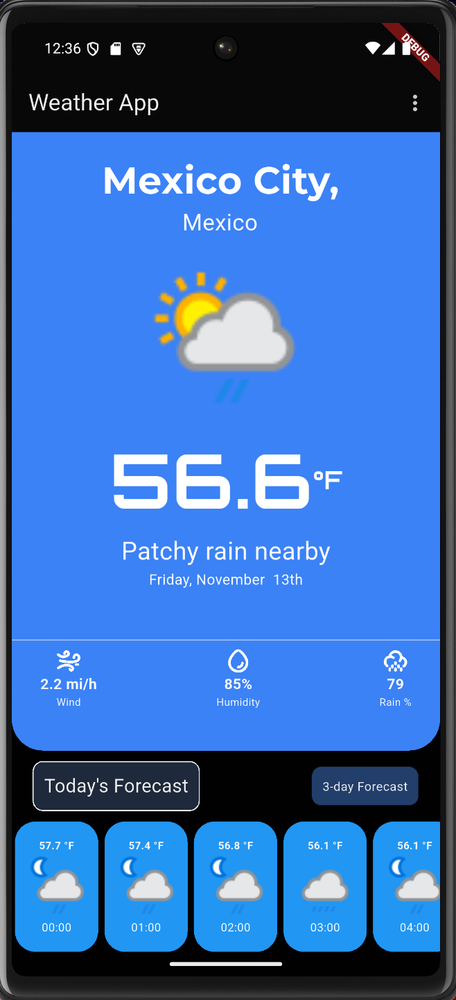
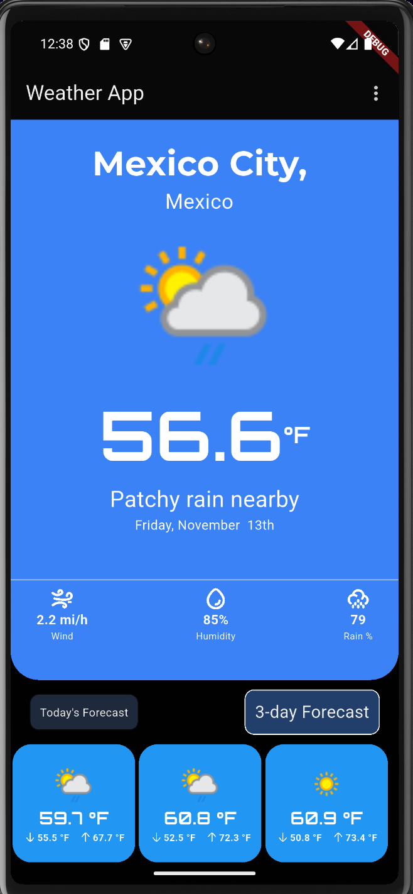
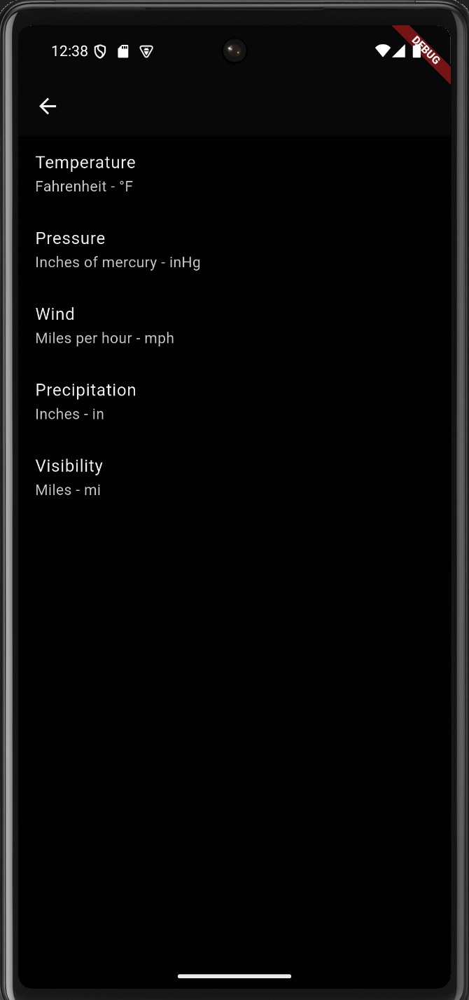

# Weather App — Flutter + Cubit

A weather app that detects your location and shows current conditions, an hourly view for today and a 3-day forecast, using data from [WeatherAPI.com](https://www.weatherapi.com/).

<p align="center">
  
  
  
</p>

## Features
- **Automatic location:** gets the device position with geolocator and turns it into a city and country with reverse geocoding.
- **Current weather, hourly and 3-day views:** switch between today's hourly details and a 3-day forecast; the forecast loads separately so the main screen appears first.
- **Unit settings:** temperature, precipitation, visibility, pressure and wind units, saved between sessions.
- **Light and dark theme**, saved between sessions.
- **Error handling:** clear messages with a Retry button when there's no internet, location services are off or permission is denied; pull to refresh.

## Tech stack
| Area | Choice |
|---|---|
| Framework | Flutter, Dart |
| State management | Cubit (flutter_bloc) — `WeatherCubit`, `AppSettingsCubit`, `AppThemeCubit` |
| Networking | http package behind an `HttpClient` interface |
| Location | geolocator, geocoding |
| Persistence | shared_preferences |
| Dependency injection | get_it |
| UI | flex_color_scheme, google_fonts, hugeicons |

## Architecture
```
lib/
├── services/       # HttpClient (abstract) + http implementation, ApiService, GeoLocationService
├── repositories/   # WeatherRepository: fetch + JSON parsing into models
├── models/         # Weather and forecast models, unit settings
├── cubits/         # Weather, settings and theme Cubits with their states
├── presentation/   # Screens (home, settings, theme) and widgets
├── enums/          # Unit types
├── core/           # Custom exceptions (API, timeout, parsing)
└── di.dart         # get_it registrations
```

**Flow:** on start, `WeatherCubit` emits `WeatherLoading`, gets the position, reverse-geocodes it and asks the repository for current weather (`WeatherLoaded`), then for the 3-day forecast. Any failure ends in `WeatherError`, which the home screen shows with a Retry button.

### Design decisions
- **The HTTP package is behind an interface.** `ApiService` depends on an abstract `HttpClient`, so `http` could be swapped for Dio or a fake in tests without touching the rest of the app.
- **Typed exceptions.** Non-2xx responses, timeouts (10 s) and invalid JSON become `ApiException`, `CustomTimeoutException` and `ParseException` instead of raw errors.
- **Location is a service with an interface.** `GeoLocationService` checks that location services are on, requests permission if needed, uses a 10-second timeout and falls back to the last known position.
- **Every path ends in a state.** Loading always resolves to Loaded or Error, so the UI never gets stuck on a spinner.

## Getting started
Requirements: Flutter SDK, an Android emulator or device, and a free API key from WeatherAPI.com.

```bash
git clone https://github.com/soulandbone/weather_app.git
cd weather_app
flutter pub get
```

The API key is kept out of the repository. Create `lib/secrets/secrets.dart`:

```dart
const String kApiKey = 'YOUR_WEATHERAPI_KEY';
```

Then run:

```bash
flutter run
```

## Roadmap
- [ ] "Open settings" button when location permission is permanently denied
- [ ] Keep the current weather on screen if only the forecast request fails
- [ ] Unit tests for the repository and Cubits (fake `HttpClient` and `GeoLocationService`)
- [ ] GitHub Actions CI (analyze + test)
- [ ] Search weather for other cities

## Author
Gustavo Pavez Gikis — Flutter developer · [LinkedIn](https://www.linkedin.com/in/gustavo-pavez-5ba72814a/) · [Portfolio](https://portfolio-gpg.vercel.app/)
